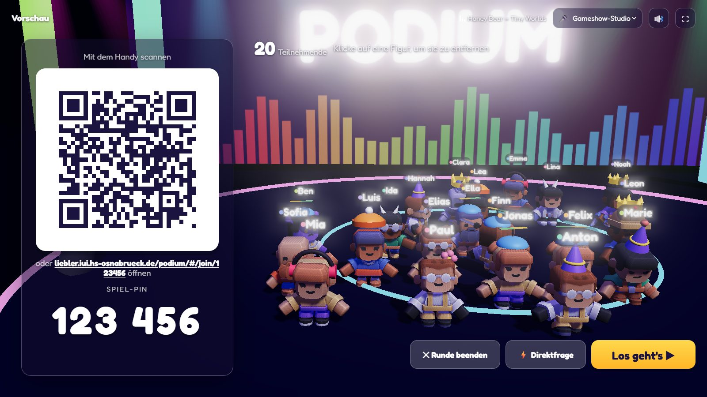
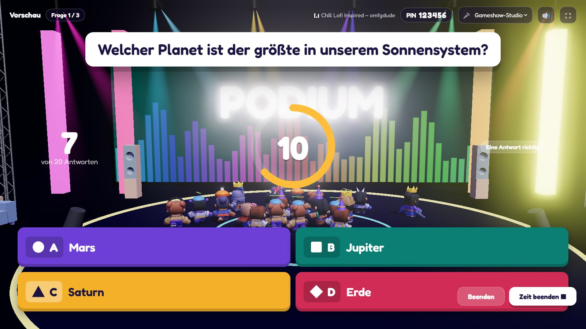
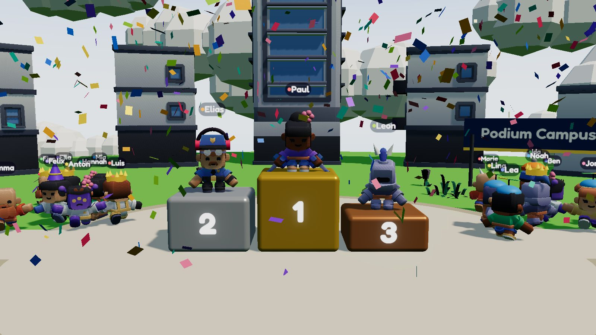
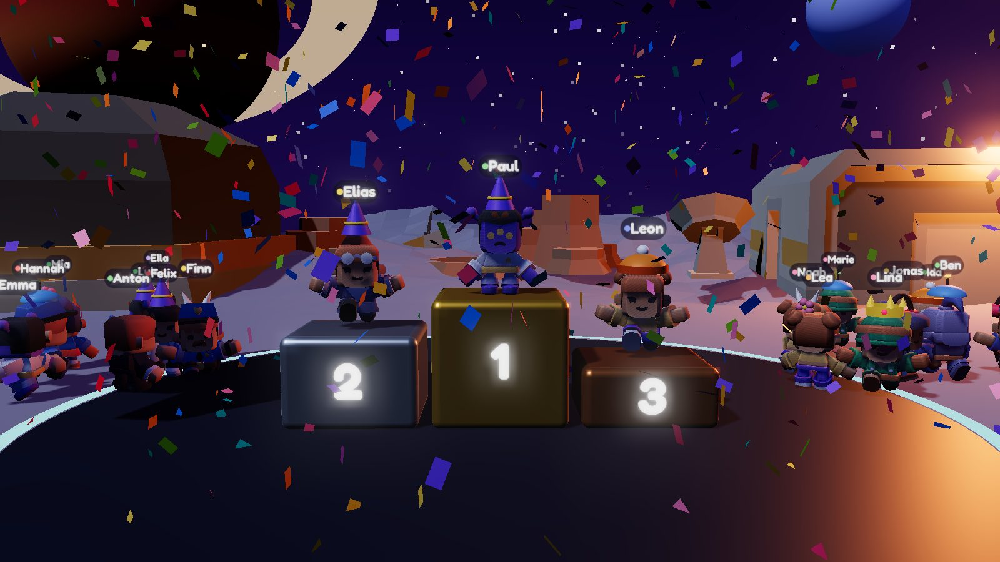
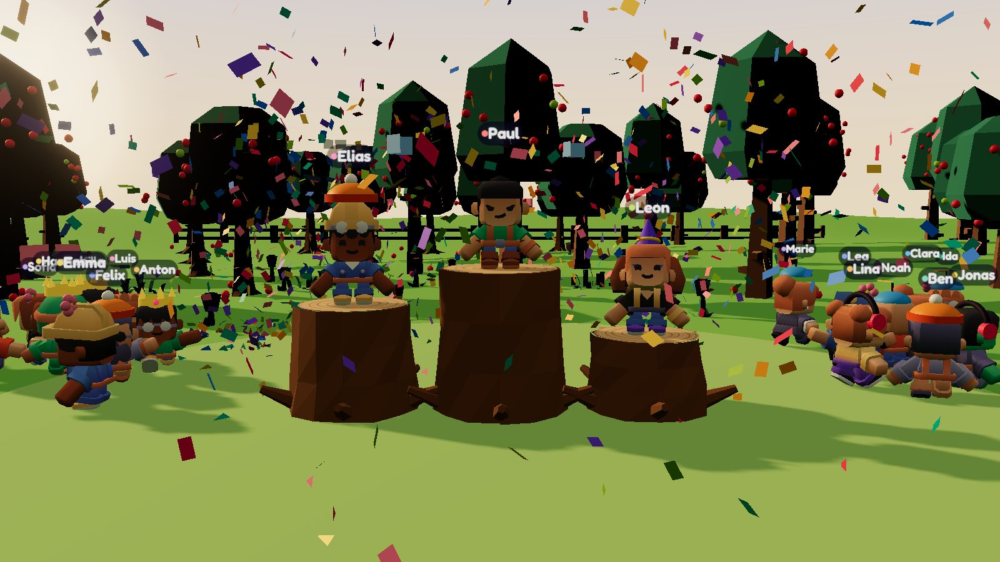
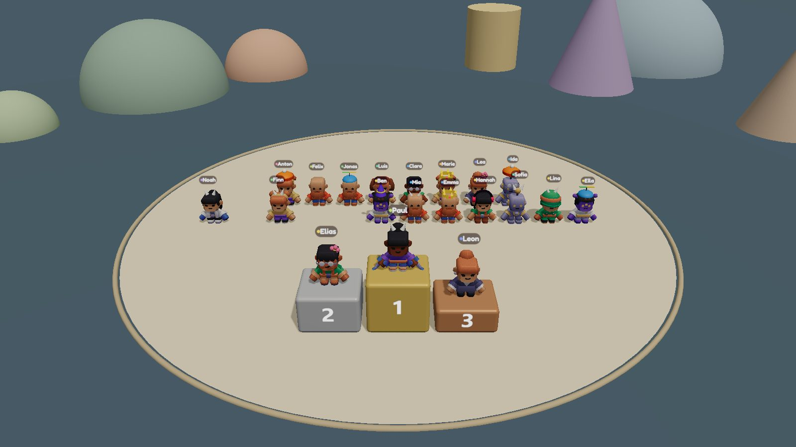

# Podium – Live-Quiz für die Lehre

**Aus dem Hörsaal wird eine Gameshow.** Podium ist ein Live-Quiz für Vorlesung, Seminar und Klassenzimmer: Die Fragen
laufen auf der Leinwand in einer animierten 3D-Welt mit Musik. Die Teilnehmenden spielen mit dem Handy mit, ganz ohne
App und ohne Anmeldung. Jede Person steht mit einer selbst gestalteten Figur auf der Bühne, und am Ende werden die drei
Besten auf dem Siegerpodest gefeiert, mit Konfetti und eigenem Sieger-Song.

Podium läuft auf dem eigenen Server. Die Daten der Teilnehmenden verlassen die Hochschule nicht, und Studierende spielen
nur mit einem selbst gewählten Spitznamen mit.


### Das kann Podium

- 📱 **Beitreten in Sekunden:** QR-Code scannen oder PIN eingeben, Spitznamen wählen, fertig. Keine App, kein Konto.
- 🎭 **Eigene Figur:** Figur und Kopfbedeckung aussuchen. Die Figur steht live in der 3D-Welt auf der Leinwand.
- 🌍 **Sieben 3D-Welten:** Gameshow-Studio, Campus-Insel, Weltraum-Arena, Stadion, Apfelwiese, Osnabrück und die
  *Ruhige Bühne*. Die Ruhige Bühne kommt ohne Bewegung, Lichteffekte und Konfetti aus, für alle, die es ruhiger mögen.
- 🎵 **Musik mit Spannungsbogen:** Warteraum-Musik, tickende Stoppuhr, Fanfaren, Konfetti und Sieger-Songs. Im
  Musikmanager lässt sich jeder Abschnitt mit eigener Musik belegen, auch mit hochgeladenen Stücken.
- ⚡ **Direktfragen jederzeit:** Spontan nachfragen, auch mitten im Quiz: Ja/Nein, „Verstanden?“, Skala, Schätzfrage
  oder ein Wort für die Word Cloud. Die Antworten sind anonym und erscheinen auf Wunsch live.
- 🏆 **Punkte für Tempo und Serien:** Wer schnell und richtig antwortet, sammelt mehr Punkte. Zwischenstände halten
  die Spannung hoch, am Ende gibt es eine Statistik zu jeder Frage.
- 🧩 **Drei Fragetypen:** Auswahl (auch Wahr/Falsch und mehrere richtige Antworten), Schätzfrage mit Toleranz und
  Reihenfolge. Fragen können Bilder, Formeln (LaTeX), Code und eine Erklärung zur Lösung enthalten.
- 📱 **Fernbedienung:** Die Leinwand lässt sich vom eigenen Handy aus steuern. Dort stehen auch die richtige Antwort,
  eigene Notizen und die nächste Frage.
- 🎯 **Flexibel in der Vorlesung:** Nur ausgewählte Fragen spielen, Fragen spontan überspringen, Räume vorab vorbereiten
  (PIN und QR-Code für die Folien) und feste Kurs-PINs je Ordner.
- 📊 **Auswertung danach:** Jede Runde lässt sich nachträglich ansehen, mit den schwierigsten Fragen auf einen Blick
  und Export als CSV oder PDF.
- ✍️ **Komfortabler Editor:** Automatisches Speichern, Umsortieren per Ziehen, Einstellungen für alle Fragen auf einmal,
  Fragen aus anderen Quizzen übernehmen. Auf Wunsch schlägt Claude Fragen aus einem Text oder PDF vor, mit dem eigenen
  API-Schlüssel.
- 📥 **Vorhandene Quizze übernehmen:** Import per Kahoot-Link, Kahoot-Tabellenvorlage (.xlsx), CSV oder JSON. Export
  als JSON.
- 🗂️ **Ordnung für viele Kurse:** Ordner, Suche, Sortierung, Papierkorb sowie 3D-Welt und Musik je Quiz.
- 👥 **Für das ganze Kollegium:** Eigene Konten mit Einladungslinks, jede Person sieht nur ihre eigenen Quizze. Quizze
  lassen sich per Link teilen, die Empfänger·innen bekommen dann eine eigene Kopie.
- 👀 **Szenen-Vorschau:** Jede Welt lässt sich mit 20 simulierten Teilnehmenden ansehen, bevor es ernst wird.

### So läuft eine Runde

| Warteraum | Frage | Lösung |
|---|---|---|
|  |  |  |
| Alle scannen den QR-Code, die Figuren laufen auf die Bühne. | Countdown, Musik und Live-Zähler der Antworten. | Antwortverteilung, Trefferquote und durchschnittliche Antwortzeit. |

### Die Welten

| | | |
|---|---|---|
|  |  |  |
| 🏫 **Campus-Insel** | 🚀 **Weltraum-Arena** | 🏟️ **Stadion** |
|  |  |  |
| 🍎 **Apfelwiese** | ⛪ **Osnabrück** | 🌙 **Ruhige Bühne** |

---

## Technik

Live-Quiz mit Leinwand (3D-Welt, Musik), Handy-Teilnahme per QR-Code, Dozentenbereich und spontanen Direktfragen.

## Voraussetzungen

- .NET SDK 11, Node.js 22+
- Der Single-File-Build nutzt `@klaus-liebler/vite-firmware-single-file` aus
  [klaus-liebler/npm-packages](https://github.com/klaus-liebler/npm-packages) per `file:`-Verweis. Erwartete Ordnerstruktur:

  ```
  repos/
    npm-packages/@klaus-liebler/vite-firmware-single-file
    podium/            ← dieses Repository
  ```

## Starten

```powershell
cd web; npm install; npm run build   # baut die Oberfläche nach ../wwwroot (index.html + index.html.br)
cd ..; dotnet run                    # http://localhost:5158 – lauscht auf allen Netzwerkschnittstellen
                                     # erster Aufruf: Ersteinrichtung legt das Admin-Konto an
```

Handys müssen den Rechner im selben Netz erreichen (ggf. Windows-Firewall für Port 5158 freigeben).
Der QR-Code enthält automatisch die LAN-Adresse; feste Adresse per `PublicBaseUrl` in `appsettings.json` setzen
(z. B. `"PublicBaseUrl": "https://quiz.example.org"`).

Entwicklung mit Hot-Reload: Backend per `dotnet run` starten, dann `cd web; npm run dev` (Port 5173, `/api` und `/hub` werden weitergeleitet).

## Aufbau

| Pfad | Inhalt |
|---|---|
| `Program.cs` | Minimal-API: Quizze, Import/Export, QR-Code, Auslieferung der Single-File-Oberfläche |
| `Game/` | Spiellogik (in-memory), SignalR-Hub, Zustandsobjekte für Leinwand/Handy, DirectMode |
| `Import/QuizImport.cs` | Kahoot-Link, Kahoot-/Podium-JSON, Kahoot-Tabellenvorlage (.xlsx), CSV |
| `Data/` | EF Core + SQLite (`podium.db`): Quizze, gespielte Runden, Direktfragen (anonym) |
| `web/` | Vite + Lit + TypeScript, Single-File-Build (`@klaus-liebler/vite-firmware-single-file`), Three.js tree-geshaked |
| `web/src/three/stage.ts` | gemeinsame 3D-Welt (Lobby → Fragen → Podest) |
| `web/src/audio/engine.ts` | Musik-Decks mit Crossfade, Stoppuhr-Ticken, Spannungskurve, Fanfaren, Effekte |
| `web/public/music/` | CC0-/gemeinfreie Musik (`tracks.json` ordnet Stücke den Stimmungen und Welten zu, Quellen in `CREDITS.md`) |
| `docs/suno-songs.md` | Texte und Stilbeschreibungen der Suno-Stücke für die Siegerehrung (inkl. Entwürfe) |
| `web/public/models/` | CC0-3D-Modelle von Kenney (Figuren, Natur, Stadt, Weltraum, Arena, Möbel) |
| `web/src/three/themes/` | 3D-Welten: Gameshow-Studio, Campus-Insel, Weltraum-Arena, Stadion, Apfelwiese, Osnabrück, Ruhige Bühne (ohne Bewegung und Effekte, für alle, die es ruhiger mögen) |
| `Music/MusicApi.cs`, `web/src/views/music-view.ts` | Musikmanager: Musik je Abschnitt (Warteraum, Fragestellung, Lösung & Statistik, Siegerehrung) pro Konto, eigene Uploads (`musik/` neben der Datenbank, Pfad per `MusicPath`) |
| `web/src/views/preview-sim.ts` | Szenen-Vorschau für Admins: spielt eine Runde mit 20 Beispielteilnehmenden lokal durch |
| `Teaching/TeachingApi.cs` | Bilder in Fragen (`bilder/` neben der Datenbank, Pfad per `MediaPath`), Papierkorb, Teilen per Link, Direktfragen-Vorlagen, Auswertung gespielter Runden (inkl. CSV), offene Räume und Fernbedienung, Kurs-PINs |
| `Teaching/AiApi.cs` | KI-Vorschläge (Claude) aus Text oder PDF; Schlüssel je Konto unter „Mein Konto“ (verschlüsselt), optional ein Server-Schlüssel `Ai__ApiKey` |
| `web/src/views/remote-view.ts`, `session-view.ts`, `shared-view.ts` | Fernbedienung, Auswertung einer Runde, geteiltes Quiz |
| `deploy/` | Bereitstellung auf liebler.iui.hs-osnabrueck.de (systemd, nginx-Schema `liebler.d/`, Sicherung) |

## Anmeldung

Dozierende melden sich mit eigenem Konto an; jede·r sieht nur die eigenen Quizze. Grundlage ist **ASP.NET Core Identity** über das
vorhandene Kontomodell (`Auth/Identity.cs`): Passwort-Hashes im bisherigen Format (PBKDF2-SHA256), Sperre nach 5 Fehlversuchen für
15 Minuten, Sicherheitsstempel (Passwortwechsel, Admin-Recht, Deaktivieren oder zweiter Faktor beenden alle Sitzungen), **zweiter Faktor**
per Authenticator-App (TOTP, mit Wiederherstellungscodes; **Pflicht für Admins**) und **Passkeys**. Solange die Datenbank kein Konto
enthält, zeigt die Anmeldeseite die **Ersteinrichtung**: Dort legt man einmalig das Admin-Konto an (kein Passwort in Konfiguration oder Log)
und richtet gleich den zweiten Faktor ein. Weitere Konten per **Einladungslink** (👥 Benutzer), Passwort vergessen per **Passwort-Link**,
Telefon verloren per „2FA zurücksetzen“. Studierende brauchen keine Anmeldung.

Die Verfahren erscheinen als Kacheln auf der Anmeldeseite und sind je Instanz schaltbar:

| Einstellung (Umgebung) | Bedeutung |
|---|---|
| `Anmeldung__Verfahren` | `Saml,Oidc,Passwort,Passkey` (Auswahl); leer = Passwort und Passkey, dazu SAML bzw. OIDC, sobald konfiguriert |
| `Saml__IdpEntityId` | Hochschul-Login (Shibboleth) wie bisher: SP-Metadaten unter `…/Saml2`, ACS `…/Saml2/Acs`, Zertifikat `schluessel/saml-sp.pfx` |
| `Oidc__Authority`, `Oidc__ClientId`, `Oidc__ClientSecret` | optional OpenID Connect (Code-Flow mit PKCE); Rückruf `…/signin-oidc`; Konten nur verknüpfen, kein automatisches Anlegen |
| `Anmeldung__MfaBeiSsoVerlangen` | Standard `true`: Admins brauchen bei SSO einen MFA-Nachweis des IdP (REFEDS-MFA bzw. `amr`), sonst fragt Podium den eigenen Code ab |
| `Anmeldung__SperreNachFehlversuchen`, `Anmeldung__SperreMinuten` | Sperre nach Fehlversuchen (Standard 5 / 15) |

Hochschul-Login: Konten werden wie bisher über die dauerhafte Kennung (subject-id, sonst pairwise-id, sonst eppn) gefunden – die frühere
Spalte `SsoId` übernimmt die Aufwertung in die Verknüpfungen (`UserLogins`) und bleibt gefüllt. Neue Mitarbeitende bekommen beim
ersten Login automatisch ein Konto (wie bisher, nur mit passender `eduPersonScopedAffiliation`).

Betrieb unter einem Unterpfad: `PathBase=/podium`, `PublicBaseUrl=https://…/podium`. Server-Bereitstellung: [deploy/README.md](deploy/README.md).

## Routen (Hash)

`#/` Dozentenbereich · `#/folder/<id>` Ordner · `#/trash` Papierkorb · `#/edit/<id>` Editor · `#/host/<pin>/<key>` Leinwand · `#/remote/<pin>` Fernbedienung (mit Anmeldung) · `#/join/<pin>` Handy · `#/ask/<pin>` anonyme Live-Fragerunde · `#/session/<id>` Auswertung · `#/shared/<token>` geteiltes Quiz · `#/music` Musikmanager · `#/music/quiz/<id>` Musik je Quiz · `#/preview/<welt>` Szenen-Vorschau (Admin) · `#/login` · `#/invite/<token>` · `#/account` · `#/users`

Editor: Strg+S speichert, Enter in einer Antwort springt zur nächsten (Umschalt+Enter = neue Zeile), Bilder per Strg+V oder Hineinziehen.

## Leinwand-Tastatur

Leertaste/Enter/→ = weiter · D = Direktfrage · M = Ton · F = Vollbild

## Lizenz

Code: MIT (siehe `LICENSE`). Musik und 3D-Modelle: CC0 bzw. gemeinfrei (Ausnahme: die mit Suno erstellten Stücke für die Siegerehrung – nicht im Repository, nur auf dem eigenen Server), Nachweise in `web/public/music/CREDITS.md` und `web/public/models/KENNEY-LICENSE.txt`.
